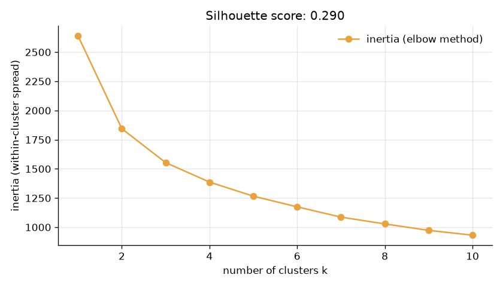

# Customer Segmentation

**Unsupervised learning · clustering.** Groups a wholesale distributor's customers by what they buy, using K-Means, with no labels given to the model.

Part of my ML portfolio, [LabOS](https://github.com/abdimajeet/labos-portfolio), where this project's training curve and results are shown in the Model Lab app.



## Results

| Metric | Value |
|---|---|
| Silhouette score | 0.290 |
| Segments | 2 |

## What I found

- Spending is very skewed (skewness up to 11.2 for delicatessen), so I log-transformed it before clustering. That way a few very large clients don't dominate the distances.
- Grocery and detergents & paper spending are strongly linked (correlation 0.92): customers who buy one buy the other.
- The elbow chart has no sharp bend, so I chose k with the silhouette score instead: it is highest at k = 2 (0.29).
- Segment 1 (252 customers, 3% retail) spends most on fresh food and grocery.
- Segment 2 (188 customers, 71% retail) spends most on grocery and milk.
- Without ever seeing the channel label, the clusters match hotel/restaurant vs retail for 86% of customers.

## How it works

- **Problem:** Find groups of customers with similar buying habits, without any labels.
- **Dataset:** UCI Wholesale Customers: 440 clients of a distributor in Portugal, annual spending in 6 product categories (Cardoso, 2014).
- **Preprocessing:** Log-transformed spending (it is very skewed) and standardised it.
- **Exploration:** Measured how skewed each category is and which categories are bought together.
- **Model:** K-Means (k-means++ initialisation, 10 restarts); k chosen with the elbow method and the silhouette score.
- **Evaluation:** Silhouette score, a description of each segment, and a check against the real channel labels (hotel/restaurant/café vs retail), which the model never saw.

| Setting | Value |
|---|---|
| model | K-Means |
| dataset | Wholesale Customers, 440 clients |
| features | 6 spending categories, log + scaled |
| k | 2 (best silhouette) |
| init | k-means++, 10 restarts |

## Run it

```bash
python -m venv .venv
.venv\Scripts\activate        # Windows; on macOS/Linux: source .venv/bin/activate
pip install -r requirements.txt
python customer_segmentation.py
```

The first run downloads the dataset into `data/`. The script prints its progress and writes `results/customer-segments.json` (scores, curve, findings) and `results/customer-segments.png` (the chart above).

## Files

- `customer_segmentation.py`: the whole project, top to bottom: load, explore, preprocess, train, evaluate.
- `common.py`: dataset download, rounding, and saving results and the chart.
- `results/`: output of the last run.

## License

Code: MIT. Datasets belong to their authors; see the dataset links in `common.py`.
